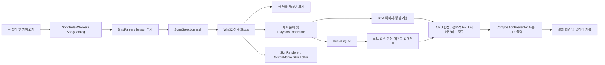

# SevenMania / BMS Player 프로젝트 안내서

작성 기준: 2026-11-07  
저장소: `BmsPlayerCpp`  
현재 작업 스냅샷: `codex/rmlui-settings-ui-test` / `9f35d2d0`

이 문서는 프로젝트의 역할, 코드 구조, 주요 실행 흐름, 빌드·검증 방법, 성능 조사와 병목 해소 기록을 한곳에서 찾기 위한 안내서다. 모든 구현 세부사항을 복제하기보다, 세부 동작과 수치가 기록된 기존 보고서로 연결한다.

> **스냅샷 주의:** 이 저장소에는 빌드 폴더, 검증 산출물, 이전 실험 자료와 현재 작업 중인 코드가 함께 있다. 작성 시점의 Git 작업 트리는 깨끗하지 않았다. 따라서 현재 작업 디렉터리의 모든 파일이 HEAD에 포함되거나, 기본 배포 실행 파일과 일치한다고 가정하면 안 된다. 날짜가 있는 보고서는 그 시점의 커밋·실행파일·설정에서 얻은 결과이며, 현재 빌드의 보증이 아니다.

## 1. 프로젝트 개요

SevenMania는 Windows용 C++ 기반 BMS 구동기다. 저장소 이름은 `BmsPlayerCpp`이며 제품명과 코드·빌드 타깃에는 `SevenMania`, `BmsPlayer`가 함께 쓰인다.

주요 작업은 다음과 같다.

- BMS 계열 채보 파일을 읽고 차트 메타데이터, 시간축 이벤트, 음원·영상 자산을 구성한다.
- 로컬 곡 라이브러리를 검색·정리하고 곡 그룹과 난이도 변형을 선곡 화면에 제공한다.
- WASAPI 기반 오디오 재생, 입력·판정·게이지·롱노트 처리, BGA와 게임 화면 출력을 제공한다.
- 기본 스킨, 사용자 스킨 패키지, 스킨 에디터와 시작 설정 런처를 제공한다.
- 파서·선곡·판정·오디오·BGA·렌더링·설정·스킨 동작을 Windows 자동 테스트로 검증한다.

이 프로젝트는 상용 BMS 실행기의 동작을 일부 참고하지만, 판정·게이지·구형 확장 명령의 효과까지 모든 외부 실행기와 완전히 동일하다고 주장하지 않는다. 호환성은 기능별 테스트와 각 보고서의 범위를 기준으로 해석한다.

## 2. 코드와 데이터의 큰 흐름



이 흐름은 역할을 설명하는 개략도다. 실제 세부 순서·스레드 소유권은 [비동기 로딩 문서](AsyncPlaybackLoading-Phase3-2026-11-05.md), [RmlUi 곡 목록 문서](RmlUiSongListIntegration.md), [스킨 런타임 문서](DefaultSkinRuntime.md)를 기준으로 한다.

### 주요 단계

1. **라이브러리 검색·가져오기** — 실행 파일 옆 `Songs`와 등록된 라이브러리 경로를 읽는다. 인덱스 worker가 파일을 발견하고 메타데이터 캐시와 곡 폴더 탐색 모델을 구성한다.
2. **채보 해석** — `BmsParser::parse`가 BMS 계열 텍스트 파일을 읽는다. `.bmson`은 `parseBmson`과 JSON reader를 통해 공통 `Chart` 모델로 변환한다. 라이브러리용 메타데이터만 가진 차트는 재생 전에 전체 재파싱될 수 있다.
3. **곡 선택** — 차트들을 곡 그룹과 난이도 변형으로 묶는다. Release 구성에서 선택 모델은 기본적으로 Rust 구현을 사용하고, C++ 어댑터가 화면용 객체를 제공한다. Win32가 선택 입력·포커스·기본 스크롤을 관리하고, RmlUi가 표시 행을 그리는 구성이다.
4. **플레이 준비** — `PlaybackLoadState`의 단계에 따라 차트, 오디오, 이미지·영상, BGA 및 플레이 리소스를 준비한다. 준비 작업은 UI를 막지 않도록 worker로 분리된 부분이 있다. 취소·세대 번호·자원 소유권은 로딩 단계의 주요 안전 조건이다.
5. **게임 실행** — 메인 창 경로가 입력, 판정, 콤보, 게이지, 게임 상태와 화면 갱신을 연결한다. 오디오 재생 시계와 그래픽 업데이트/출력 시계는 서로 구분한다.
6. **결과·복귀** — 기록을 저장하고 결과 화면을 표시한 뒤 이전 선곡 위치로 돌아간다. 화면 전환 애니메이션과 스킨 바인딩은 플레이 시스템과 분리된 UI 층으로 연결한다.

## 3. 주요 기술과 언어의 책임

| 영역 | 현재 책임 | 대표 위치 |
|---|---|---|
| C++20 / Win32 | 게임 호스트, 입력·창 메시지, 실시간 재생 조율, 오디오·그래픽 통합, 설정·런처·스킨 시스템 | `src/Main.cpp`, `src/AudioEngine.*`, `src/CompositionPresenter.h`, `src/Launcher.cpp` |
| Rust | 곡 선택 모델(그룹·정렬·선택·변형 순환)의 Release 구현 및 독립적인 C ABI; 별도의 파서 helper crate는 opt-in 실험 | `rust/song_selection/`, `src/SongSelectionRust.cpp`, `rust/bms_backend/`, `src/RustBackend.*` |
| RmlUi / RCSS | 선곡 행 및 설정 UI의 표시 계층. 목록 입력과 권위 있는 선택 상태는 Win32·선택 모델에 남음 | `Assets/UI/`, `src/RmlSongListRenderer.cpp`, `src/RmlSettingsHost.*` |
| Direct3D 11 / Direct2D / GDI | GPU 노트·화면 출력 및 CPU/GDI fallback, 일부 합성·텍스트·스킨 출력 | `src/CompositionPresenter.h`, `src/Main.cpp`, `src/skin/` |
| Media Foundation | 지원 오디오 및 영상 디코딩 경로 | `src/AudioEngine.cpp`, `src/VideoBga.h`, `src/AsyncVideoBga.h` |
| C# WPF | 독립 선곡 UI 실험/프런트엔드. 기본 `BmsPlayer.exe`의 화면이라고 보지 말 것 | `frontend/BmsSongSelection/` |
| Python / PowerShell | 측정 실행, 분석, 테스트 데이터 생성, 에셋·패키지 보조 도구 | `tools/`, `Validation/` |

언어 전환 제안 대화의 결론을 코드 구조에 적용할 때도, 언어를 바꾸는 것만으로 CPU 픽셀 처리나 GPU/CPU 복사가 사라지지는 않는다. 실시간 입력·오디오·Win32·DirectX 호스트는 C++에 두고, Rust는 소유권 경계가 선명하고 독립 테스트가 가능한 모델·파싱 작업부터 제한적으로 담당하는 방향이 적합하다. 실제 파서의 Rust 전환은 기본 경로가 아니라 별도 옵션이다.

### Rust/C++ 경계

- `BMS_ENABLE_RUST_SONG_SELECTION`은 현재 CMake 소스에서 기본 `ON`이다. Windows x64 MSVC Release에서 Rust 정적 라이브러리를 사용하고 Debug는 MSVC CRT 차이 때문에 기존 C++ 구현 경로를 쓴다.
- `rust/song_selection/include/BmsSongSelectionAbi.h`는 고정 폭 C ABI, UTF-8 포인터+길이, 불투명 모델 핸들, caller-owned 출력 버퍼를 정의한다. C++는 Rust 내부 포인터를 소유하지 않는다.
- `BMS_USE_RUST_BACKEND`는 기본 `OFF`다. 이 옵션은 별도 `rust/bms_backend` 실험으로, 기본 BMS 파서 구현을 의미하지 않는다.
- RmlUi와 Rust는 별개다. 곡 선택 모델을 Rust로 사용해도 렌더러는 C++/RmlUi/DX11 조합이다.
- 상세 계약과 단계별 완료 범위: [Rust 선곡 FFI 계약](RustSongSelectionFfiContract.md), [Rust 선곡 로드맵](RustSongSelectionMigrationRoadmap.md).

## 4. 소스 트리 빠른 안내

### 핵심 엔진

| 경로 | 역할 |
|---|---|
| `src/Main.cpp` | Win32 창·메시지 루프와 선곡/준비/플레이/일시정지/결과 화면을 잇는 메인 호스트. 일부 게임 조율 코드가 집중되어 있어 범위 밖 리팩터링을 피한다. |
| `src/BmsParser.cpp`, `src/BmsParser.h` | BMS 명령·채널, 공통 `Chart`, 재생 이벤트·진단 구성 |
| `src/BmsonParser.h`, `src/JsonValue.h` | bmson JSON 읽기와 공통 차트 이벤트 변환 |
| `src/BmsControlFlow.h`, `src/BmsText.h` | 조건 분기 및 문자 인코딩 처리 |
| `src/AudioEngine.cpp`, `src/AudioEngine.h` | 채보 음원 준비·믹싱·오디오 출력·샘플 트리거 |
| `src/SongLibrary.*`, `src/SongCatalog.*`, `src/SongIndexWorker.h` | 라이브러리 수집·인덱싱·메타데이터 및 비동기 작업 |
| `src/SongSelection.*`, `src/SongSelectionRust.cpp` | 그룹·정렬·선택·난이도 변형 모델과 C++/Rust 연결 |
| `src/PlaybackLoadState.h`, `src/PlaybackLoadJob.h`, `src/PlaybackLoading.inl`, `src/PlaybackLoadRuntime.inl` | 플레이 준비 단계와 로딩 상태 전이 |
| `src/Judgement.h`, `src/LongNoteHold.h`, `src/GrooveGauge.h`, `src/ResultScore.h` | 판정, 롱노트, 게이지, 점수·랭크 모델 |
| `src/BgaRaster.h`, `src/BgaTimeline.h`, `src/BgaVideoLayers.h`, `src/AsyncVideoBga.h`, `src/VideoBga.h` | BGA 타임라인·픽셀 합성·비동기 영상 재생 |
| `src/FramePacer.h`, `src/FrameStatistics.h`, `src/PerformanceTrace.h` | 프레임 정책·통계·개발용 계측 |
| `src/CompositionPresenter.h`, `src/HybridFrame.h` | D3D11 화면 출력과 선택적 하이브리드 합성 경로 |

### UI, 스킨, 런처

| 경로 | 역할 |
|---|---|
| `src/RmlSongListRenderer.*`, `Assets/UI/song-list.*` | 곡 목록 행 표시 및 스타일 |
| `src/RmlSettingsHost.*`, `Assets/UI/settings.*`, `src/SettingsRml*.inl` | 설정 UI와 네이티브 fallback 연결 |
| `src/skin/` | `.semaskin` 패키지 로드, 데이터 바인딩, 요소 레이아웃·애니메이션·렌더링 |
| `src/editor/` | SevenMania 스킨 에디터 문서 모델·화면·편집 기능 |
| `Assets/Skins/DefaultSkin/` | 기본 스킨 패키지와 기본 참조 화면 |
| `src/Launcher.cpp`, `src/SharedStartupSettings.h` | 앱 시작 설정, 경로·라이브러리·스킨 옵션을 다루는 런처 |
| `Assets/` | 폰트, UI, 기본 HUD 이미지, 아이콘·효과음 등 배포 리소스 |

### 빌드와 검증

| 경로 | 역할 |
|---|---|
| `CMakeLists.txt`, `cmake/` | 메인 플레이어, 라이브러리, 테스트, 선택적 라이브러리 빌드 정의 |
| `tests/` | 합성 fixture와 단위·통합 테스트 |
| `samples/` | 저장소에 포함하는 작은 합성 호환성 샘플 |
| `tools/` | 성능 기록·분석과 유틸리티 스크립트 |
| `docs/` | 설계, 호환성 감사, 단계별 구현, 검증 결과와 실험 보고서 |
| `Validation/`, `build-*`, `out/`, `PerformanceSamples/` | 캡처·임시 빌드·실험 산출물이 섞일 수 있음. 소스나 배포 자료로 무조건 취급하지 않는다. |

## 5. BMS 호환성 범위

현재 `Chart` 모델과 구현 보고서에는 기본 BPM 및 확장 BPM, STOP, 마디 길이, 조건 분기와 SWITCH 계열, BGM·WAV, LNOBJ/LNTYPE/LNMODE, SCROLL/SPEED/STP, RANK/EXRANK/TOTAL, mine·invisible note, BGA 레이어·이벤트 영상, PREVIEW/TEXT/CHARSET, 공유 자산, bmson 및 복수 키 모드 처리가 기록돼 있다.

파서가 명령을 읽는 것과 실제 플레이에서 타이밍·오디오·판정·화면에 반영되는 것은 다르므로, “명령 이름이 코드에 존재한다”만으로 완전 호환 판정을 내리면 안 된다. 자세한 기능별 동작, 샘플 번호, 실행기 비교 범위, 미검증 코덱 및 역사적 변형 한계는 다음 자료를 기준으로 한다.

- [BMS 호환성 구현·검증 결과](BMS-Compatibility-Implementation-2026-10-23.md) — 구현 이후의 범위와 테스트 기록
- [BMS 호환성 감사](BMS-Compatibility-Audit-2026-10-23.md) — 구현 전 상태 보존. 현재 상태로 오해하지 않는다.
- [키 모드 지원 현황](KeyModeSupport-2026-11-09.md) — 5K/7K/10K/14K/PMS의 입력·표시 현황과 알려진 한계
- [BMS Command Memo 및 beatoraja 비교 참고] — 위 두 문서의 출처·한계 절을 참조한다.

호환성 보고서도 모든 실행기·모든 코덱·실제 장치의 A/V 동기화와 완전한 의미 동일성을 증명하지 않는다. 실제 곡에 대한 판단은 사용하는 곡의 구체적인 채보와 재현 로그로 추가 검증한다.

## 6. 주요 사용자 기능

현재 프로젝트와 날짜별 설계 보고서에서 확인되는 기능은 다음과 같다. 저장된 사용자 설정과 현재 Release 실행파일 상태는 별도로 확인해야 한다.

- **곡 라이브러리:** 하위 폴더 검색, 가져오기/등록, 중첩 폴더 탐색, 메타데이터 캐시, 곡별 차분 그룹, 제목·난이도 정렬.
- **곡 선택:** 곡 정보와 랭크·플레이 기록, 채보 변형 선택, 부드러운 난이도/목록 이동, preview 음악·BGA, 폴더·설정·키 가이드, 선택 배경 설정.
- **플레이:** 7+1 기본 레인, 사용자 키 설정, 배속·HI-SPEED FIX(`src/HiSpeedFix.h`)·판정·게이지·레인 가드, 롱노트·스크래치·판정·콤보, 일시정지·재시작·연습 모드.
- **결과:** 점수·랭크·클리어/실패 및 채보별 기록 표시, 선곡 화면 복귀.
- **시작 준비:** 준비 화면에서 노트 프리뷰와 배속·레인 설정을 할 수 있는 단계적 비동기 로딩 흐름.
- **그래픽·시스템:** GPU 렌더링 토글, 해상도·화면 모드·프레임 목표·선곡 화면 프레임(60/120, `src/SelectFrameClock.h`)·DirectComposition 및 NVIDIA Reflex 관련 설정, 자원 표시와 성능 제한 옵션. 특정 옵션의 표시 조건·지원 상태는 현재 설정 코드와 장치에서 확인해야 한다.
- **스킨:** 기본 스킨, 요소별 바인딩·레이아웃·애니메이션, 에디터에서의 요소 편집 및 미리보기. 스킨이 대체하지 않는 일부 화면 요소는 엔진 기본 구현이 그릴 수 있다.
- **런처:** 시작 환경 설정과 게임 시작 전 설정. 기본 게임과 같은 설정 경로를 공유하는 구조다.

세부 설계 문서: [Song Library](SongLibrary.md), [Song Library 2](SongLibrary2-2026-11-03.md), [선곡·설정 개요](SelectionAndSettings-2026-11-05.md), [플레이 로딩 상태](PlaybackLoadState-Phase2-2026-11-05.md), [비동기 플레이 로딩](AsyncPlaybackLoading-Phase3-2026-11-05.md), [플레이 프리뷰](PlayPreview-Phase4-2026-11-06.md), [기본 스킨 런타임](DefaultSkinRuntime.md), [스킨 포맷](SevenManiaSkinFormat-v1.md).

## 7. 오디오·BGA·화면 출력

### 오디오

`AudioEngine`은 차트의 BGM/키음 이벤트를 준비하고, WAVCMD/볼륨·피치·slice 등 지원 기능을 PCM 경로에 반영한다. 오디오 시계는 노트 판정 및 BGA 시각 정렬의 기준 중 하나다. WASAPI 출력 모드와 버퍼 설정, preview/배경음/효과음의 세부 규칙은 해당 날짜의 설정·오디오 문서 및 실제 설정값을 확인한다.

2026-11-22 안정화 작업으로 다음이 바뀌었다.
- **같은 키음 재트리거:** 같은 WAV 번호가 다시 울리면 이전 소리를 그 순간 끊는다(LR2·beatoraja와 같음). 딸깍 소리를 막으려고 64프레임(약 1.4ms) 동안 줄여 끊는다. 판단은 WAV 번호 기준이며, 내용이 같아 디코딩 버퍼를 공유하는 다른 번호는 끊지 않는다(`AudioEngine::startSongVoice`).
- **오디오 장치 분실:** 플레이 중 출력 장치가 사라지면(분리·비활성화) 그 자리에서 일시정지한다. 계속하면 그 위치에서 현재 기본 장치로 다시 연다. 일시정지 중 분리된 경우도 같다. 선곡·결과 화면은 1초 간격으로 UI 소리 출력을 다시 연다(`pollAudioDevice`, 판단은 `PlayOutcome.h`의 `audioRecovery`). 장치는 살아 있고 기본 장치만 바뀐 경우는 따라가지 않는다.
- **로딩 중 포커스 상실:** 플레이 로딩·시작 전 대기 중 창이 포커스를 잃으면 곡이 일시정지 상태로 시작한다. 포커스가 먼저 돌아오면 평소처럼 시작한다.

### BGA

이미지와 영상은 공통 타임라인/레이어를 통해 표시된다. 일부 영상 디코딩은 worker에서 동작하지만, 프레임 복사·스케일·레이어 합성 또는 GPU 업로드가 CPU 경로에 남을 수 있다. 백그라운드 디코딩을 사용한다고 해서 모든 BGA 작업이 GPU에서 실행된다는 뜻은 아니다.

관련 기록: [Random BGA 동기화 조사](Random-Bga-Sync.md), [BGA 게임플레이 조사](BgaGameplayStudy-2026-11-01.md), [영상 자산 준비](BgaAssetPreparation-2026-10-30.md), [Retained Backdrop](RetainedBackdrop-2026-10-30.md), [비디오 프레임 스케일링](VideoFrameScaling-2026-10-30.md), [하이브리드 업로드 최적화](HybridUploadOptimization-2026-11-02.md).

### 렌더링·출력 용어

- **CPU/update FPS:** 게임 상태와 입력을 처리하는 루프의 횟수다.
- **draw/paint FPS:** 화면 그리기 함수가 수행된 비율이다. Win32의 추가 Paint와 VSync 설정 때문에 update FPS와 같지 않을 수 있다.
- **API 제출 간격/FPS:** Present 또는 화면 제출 API가 성공한 간격이다. 실제 scanout 시각이 아니다.
- **Output FPS/모니터 주사율:** 실제 표시 단계에 가까운 개념이다. PresentMon, ETW, GPUView 등 외부 수집 없이는 현재 CPU 타이머만으로 정확히 단정할 수 없다.
- **DirectComposition 설정과 `BMS_HYBRID_RENDERER`:** 서로 다른 개념이다. DirectComposition 토글이 컴파일된 배경 보존·부분 업로드 경로를 자동으로 켠다고 가정하지 않는다.
- **G-SYNC:** 모니터/드라이버 기능이며, 앱의 자체 FPS 통계나 DirectComposition 토글만으로 활성화를 입증할 수 없다.

렌더링 성능 개요는 [Hybrid Renderer](Hybrid-Renderer.md), [Output Cadence](Output-Cadence.md), [Rendering Performance](RenderingPerformance.md)를 참고한다.

## 8. 프레임 안정성과 병목 해소 기록

### 해석 원칙

프로파일링 결과는 곡·스킨·해상도·기기·프레임 설정·실험 바이너리에 한정된다. 서로 다른 보고서의 숫자를 하나의 전후 비교로 이어 붙이지 않는다. 평균 FPS와 함께 P95/P99/P99.9, 1% Low, 분산, 입력 처리, 제출 간격, 오디오·영상 품질을 본다. 중첩된 부모·자식 scope는 합산하지 않는다. CPU API 소요시간을 GPU 작업시간이나 모니터 표시시간으로 부르지 않는다.

### 실험·측정 이력

| 시기·자료 | 조사/변경 | 측정 결과와 해석 |
|---|---|---|
| 2026-10-16 이전 성능 작업 | 노트·텍스트·HUD 렌더링 경로를 프로파일링하고 일부 캐시·불필요한 픽셀/합성 작업을 개선 | 특정 곡·GPU 설정에서의 결과는 [RenderingPerformance.md](RenderingPerformance.md)에 있다. 전체 장치나 모든 스킨의 보장은 아니다. |
| 2026-10-23~24: 병목 계측 | 입력, 판정, 텍스트, 노트, BGA, 오디오 락, allocation, Present 등에 사전 할당 메모리 계측을 추가한 별도 실험. 게임 기능을 빼지 않고 replay를 사용 | 최초 보고서는 [frame_bottleneck_analysis.md](frame_bottleneck_analysis.md). GDI `GdiFlush` 대기가 한 실행에서 54.183ms였지만 드라이버 대기와 OS 선점을 분리하지 못했다. |
| 2026-10-24: 독립 HUD 실험 | E1: 이미 외곽선 처리된 텍스트의 항등 후처리 생략. E2: 같은 크기의 GDI DC/DIB 재사용. E3/E4는 별도 분리 | 특정 GPU Creamy replay 3회 중앙값에서 E1+E2 P99 2.379→1.918ms, P99.9 3.259→2.809ms. 실제 표시·입력 지연까지 통과한 최종 배포 승자는 확정하지 않았고, CPU 모드 회귀/출력 상태 상호작용도 문서에 남아 있다. ([실험 보고서](frame_optimization_experiments.md)) |
| 2026-10-30: 병목 재검토 | 코드·기존 보고서 정적 검토. 전체 화면 복사/업로드, CPU 영상 스케일·레이어 합성, BGA 캐시 미스, HUD 텍스트를 후보로 제시 | 이 보고서는 새 측정을 실행하지 않았다. 당시 `build-rmlui-song-list`는 `BMS_HYBRID_RENDERER=OFF`였지만 현재 CMake 기본값과 개별 빌드 캐시는 다를 수 있다. ([보고서](SevenMania-Performance-Bottleneck-Report-2026-10-30.md)) |
| 2026-10-31: 메모리 전환 검사 | 곡·채보 변경 300회, 플레이 진입/퇴장 90회 등 반복 검사 | 테스트 종료 시 미리보기 캐시 정리 후 Private Bytes 260.46MiB로 예열 기준 262.66MiB보다 낮았고 GDI 객체는 109로 안정적이었다. 반복 종료 후 즉시 누수 수정을 정당화할 근거는 없었다. 긴 세션·전체 GPU/드라이버 자원·모든 코덱을 입증한 것은 아니다. ([보고서](MemoryTransitionReport-2026-10-31.md)) |
| 2026-11-02: Reflex/FramePacer 조사 | OFF/ON 및 수치 제한·무제한 경로를 비교. FPS 격자 대기와 SDK 대기를 구분 | 고속 수치 제한의 일부 페이싱은 개선됐지만 무제한/Reflex ON의 평균 또는 1% Low가 충분히 개선되지 않았고 CPU 처리 구간이 느린 1%에 큰 비중을 차지했다. 입력-물리 표시 지연 전체를 측정한 것은 아니다. ([Reflex Frame Pacing](ReflexFramePacing-2026-11-02.md), [Latency Stage 5–6](Latency-Stage56.md)) |
| 2026-11-02: 영상 프레임 재사용 | `uploadHybrid`에서 이전 `AsyncVideoBga::Frame`과 큰 픽셀 벡터의 실제 해제가 UI 렌더 스레드에 생기는 것을 측정하고, decoder worker에서 최대 3개 프레임 버퍼를 재사용하는 독립 실험 | 같은 진단 바이너리 일부 20초 비교에서 CPU P99 1.4517→1.2605ms 및 1% Low 620.1→698.2FPS (r1), 1.5522→1.2699ms / 572.8→694.2FPS (r2). 프레임 할당은 각 522→3, 525→3회로 감소. 정지 이미지 단독 조건은 개선되지 않았고 풀은 최대 15.82MiB 추가 픽셀 메모리를 유지했다. 최악 프레임·장시간 메모리 위험을 제거한 것은 아니다. ([상세 측정](HybridUploadOptimization-2026-11-02.md)) |
| 2026-11-02: GPU 사용량 계측 | GPU 자원 사용량 폴링이 UI 경로에 영향을 주는지 비동기 폴링 대조 등 | 소수 표본에서 일부 CPU 구간이 좋아졌다는 대화 기록이 있으나, 이를 모든 게임 장면에 통용되는 FPS 개선으로 일반화하지 않는다. 원시 절차와 결과가 있는 측정보고서를 우선한다. |

### 현재 가장 중요한 교훈

1. **입력/판정이 곧 병목이라는 가정은 측정으로 뒷받침되지 않았다.** 특정 replay에서 `judge_logic_ms`, 오디오 락, 노트 수와 프레임 간격의 상관은 작았고, 텍스트 캐시 미스나 BGA/업로드와 관련된 비용이 더 강한 후보였다.
2. **BGA는 조건부 병목이다.** 이미지가 바뀌지 않을 때와 영상이 전환되는 구간의 비용은 다르다. 프레임 재사용은 실제 큰 벡터 해제/할당 횟수를 줄였지만 CPU 복사·memcmp·GPU 업로드와 드문 최악 지연은 남았다.
3. **GPU 설정은 전체 GPU 렌더링을 뜻하지 않는다.** 노트가 GPU에서 그려져도 BGA 확대·레이어 처리, HUD 또는 백버퍼 업로드가 CPU를 사용할 수 있다.
4. **게임 FPS와 부드러운 출력은 별도 목표다.** 높은 CPU update FPS가 안정적인 Present 간격이나 실제 디스플레이 출력을 보장하지 않는다.
5. **Rust 전환은 이 병목의 직접 처방이 아니다.** 픽셀 이동 위치·불필요한 재생성·버퍼 수명·동기화·출력 큐가 병목이라면 처리 위치와 자원 흐름을 바꾸는 실험이 우선이다.

전체 1차 분석·정량 비교·하이브리드 보고서는 [frame_bottleneck_analysis.md](frame_bottleneck_analysis.md), [frame_optimization_experiments.md](frame_optimization_experiments.md), [HybridUploadOptimization-2026-11-02.md](HybridUploadOptimization-2026-11-02.md), [SevenMania-Performance-Bottleneck-Report-2026-10-30.md](SevenMania-Performance-Bottleneck-Report-2026-10-30.md)에 있다. 실험 기록을 최종 기본값/메인 브랜치 승인의 증거와 혼동하지 않는다.

## 9. 빌드·테스트·배포

### 주요 요구 환경

- Windows 10/11 x64
- Visual Studio 2026의 Desktop development with C++ 구성요소 및 Windows SDK
- CMake 3.24 이상
- 기본 RmlUi 빌드용 초기화된 `third_party/RmlUi` 및 `third_party/freetype` submodule
- Release Rust 선곡 모델 빌드용 프로젝트 고정 Rust toolchain/Cargo

현재 CMake 소스에서 관찰한 주요 옵션:

| 옵션 | 소스 기본값 | 의미 |
|---|---:|---|
| `BMS_ENABLE_RUST_SONG_SELECTION` | ON | Release에서 Rust 선택 모델. Debug는 C++ 구현 경로 |
| `BMS_USE_RUST_BACKEND` | OFF | 별도의 Rust BMS helper 실험 |
| `BMS_ENABLE_RMLUI`, `BMS_ENABLE_RMLUI_SONG_LIST`, `BMS_ENABLE_RMLUI_SETTINGS` | ON | RmlUi 런타임·곡 목록·설정 표시 |
| `BMS_HYBRID_RENDERER` | ON | 하이브리드 렌더 경로를 빌드에 포함 |
| `BMS_ENABLE_NVIDIA_REFLEX` | ON | 선택적 NVIDIA Reflex 연결을 빌드에 포함 |
| `BMS_USE_TRACY`, `BMS_USE_MIMALLOC`, `BMS_USE_ONETBB` | OFF | 실험 계측기·할당기·작업 스케줄러 옵션 |

빌드 디렉터리별 `CMakeCache.txt`가 위 기본값을 덮어쓸 수 있다. 특히 오래된 `build-*` 폴더나 복사된 Release는 현재 소스 옵션과 다를 수 있으므로, 측정·배포 전 CMakeCache, 빌드 로그, 바이너리 해시를 확인한다.

### 기본 빌드 절차

```powershell
git submodule update --init --recursive
cmake -S . -B Build-Release -G "Visual Studio 18 2026" -A x64
cmake --build Build-Release --config Release --target BmsPlayer --parallel 4
ctest --test-dir Build-Release -C Release --output-on-failure
```

기본 사용자용 실행파일의 경로는 프로젝트 지침상 `Build-Release/Release/BmsPlayer.exe`다(2026-11-18부터). 이전 기본 폴더 `build-rmlui-song-list/`는 2026-11-09부터 동결되어 이전 결과물로만 보존한다. CMake 옵션이나 출력 이름을 변경한 실험 빌드는 이름과 경로가 다를 수 있다. 기본 EXE가 실행 중 잠겨 있으면 프로세스를 임의로 종료하거나 다른 이름으로 대체하지 않는다.

`ctest`에는 파서, 호환성, 음원, 판정, 롱노트, 게이지, BGA/영상, 프레임 통계, 스킨·RmlUi·설정, 런처 테스트가 등록되어 있다. 프로파일/진단 target 일부는 기본 빌드에서 제외된다. 자동 테스트 통과는 실제 고주사율 모니터, 사용자 곡·영상 코덱, 물리 입력 지연, 장시간 사용 전체 검증을 대신하지 않는다.

테스트 목적별 target 이름은 `CMakeLists.txt`를 기준으로 확인한다. 성능 비교는 같은 바이너리·곡·랜덤 시드·설정·입력 replay로 여러 번 순서를 바꿔 실행해야 한다. 측정 중 빌드나 다른 테스트를 동시에 실행하지 말고, 실행파일·설정·채보 해시와 CSV manifest를 보존한다.

### 설정·개인 파일·배포 자료

- 게임 설정 경로는 `%APPDATA%\BmsPlayer\keybindings.ini`다. 플레이 기록 및 라이브러리 캐시의 구체 경로는 해당 기능 코드·문서를 확인한다.
- 보통 실행 폴더 옆 `Songs`에 개인 곡을 둔다. 개인 곡 폴더는 소스·샘플·커밋에 포함하지 않는다.
- `.semaskin` 및 커스텀 이미지·폰트·사운드는 배포 자산과 분리해 보존한다. 실행 파일 옆 `Assets` 레이아웃이 런타임 경로에 영향을 준다.
- `GitHub-Upload/`, `dist-trial/`, `outputs/`, `build*/`, `Validation/`은 용도가 다르며, 폴더 이름만으로 순수한 배포물 또는 추적 파일이라고 판단하지 않는다.

## 10. 기존 문서 색인

### 성능·출력·메모리

- [프레임 병목 1차 분석](frame_bottleneck_analysis.md)
- [프레임 최적화 실험 비교](frame_optimization_experiments.md)
- [SevenMania 성능 병목 정적 조사](SevenMania-Performance-Bottleneck-Report-2026-10-30.md)
- [Hybrid Renderer](Hybrid-Renderer.md), [Output Cadence](Output-Cadence.md)
- [Reflex CPU 기여도](ReflexCpuAttribution-2026-11-02.md), [Reflex 프레임 페이싱](ReflexFramePacing-2026-11-02.md)
- [하이브리드 영상 버퍼 재사용 결과](HybridUploadOptimization-2026-11-02.md), [ETW 수집 절차](HybridUpload-ETW-Collection.md)
- [메모리 전환 반복 검사](MemoryTransitionReport-2026-10-31.md)
- [Rendering Performance](RenderingPerformance.md), [FPS regression](FPS-Regression-2026-10-23.md)

### 파서·곡 라이브러리·재생

- [BMS 호환성 감사](BMS-Compatibility-Audit-2026-10-23.md), [BMS 호환성 구현 결과](BMS-Compatibility-Implementation-2026-10-23.md)
- [Song Library](SongLibrary.md), [Song Library 2](SongLibrary2-2026-11-03.md), [자동 폴더](AutomaticSongFolders-2026-11-03.md)
- [난이도표](DifficultyTables-2026-11-22.md): 표 등록·새로고침, 곡 선택 화면의 표·레벨 폴더, MD5/SHA-256 대조
- [선곡·설정](SelectionAndSettings-2026-11-05.md), [플레이 로딩 상태](PlaybackLoadState-Phase2-2026-11-05.md), [비동기 로딩](AsyncPlaybackLoading-Phase3-2026-11-05.md)
- [프리뷰](PlayPreview-Phase4-2026-11-06.md), [선곡 오디오](SelectionAudio-2026-11-07.md), [효과음 · 음악 폴더](SystemSoundFolders-2026-11-18.md), [BGA 동기화](Random-Bga-Sync.md)

### 스킨·화면·에디터

- [RmlUi 곡 목록](RmlUiSongListIntegration.md), [RmlUi 설정 단계 0](RmlUiSettings-Phase0-Baseline.md), [설정 이전 계획](RmlUiSettingsMigrationPlan.md)
- [기본 스킨 런타임](DefaultSkinRuntime.md), [기본 스킨 템플릿](DefaultSkinTemplate.md)
- [SevenMania 스킨 형식](SevenManiaSkinFormat-v1.md), [스킨 디자인](SevenManiaSkin-Design.md), [스킨 에디터 MVP](SevenManiaSkinEditor-MVP.md)
- `SevenManiaSkin-Phase*-Implementation.md`와 `SevenManiaSkin-Phase4-Progress.md`는 단계별 구현 범위를 담는다.
- [LR2 스킨 호환 현황](Lr2SkinCompatibility.md), [LR2 파서 규칙](Lr2SkinPhase1.md)
- [런처](Launcher-2026-11-03.md), [결과 기록 표시](PreviousRecordDisplayFix-2026-11-02.md)

## 11. 확인이 필요한 항목과 운영 원칙

- 현재 실행파일이 현재 소스와 같은 커밋·옵션으로 빌드됐는지 확인한다.
- 수치 FPS, Present 제출률, Output FPS, 모니터 VRR 상태를 한 지표로 취급하지 않는다.
- BGA 동기화·영상 첫 프레임·영상 seek/loop·CPU/GPU fallback은 코덱과 곡 이벤트 배치에 따라 별도로 검증한다.
- Rust 파서 helper, mimalloc, oneTBB, Tracy는 기본 기능과 실험 기능을 구분한다. 옵션이 있다는 이유만으로 기본 Release가 해당 라이브러리를 쓴다고 결론내리지 않는다.
- 스킨 런타임이 일부 화면을 대체하더라도 노트·일시정지 등 전 기능이 사용자 스킨으로 대체되었다는 의미는 아니다.
- 실험에서 성능 향상이 관찰돼도 기능·입력·오디오·영상 품질 회귀가 없는지 별도로 확인하고, 더 나은 평균 FPS 하나만으로 채택하지 않는다.
- 로그·CSV·화면 캡처와 실사용 곡은 개인정보·라이선스·배포 경계를 확인한 뒤 공유한다.

## 12. 참고한 대화와 기록의 구분

- [소스별 언어 전환 제안](thread://01a16ca8-ada6-7620-846b-648cea4f03ed?hostId=local): 기존 소스의 책임을 확인하고 언어별로 맡길 만한 역할을 검토한 대화. 본 문서는 그 제안을 현재 C++/Rust 경계와 맞춰 정리했다.
- [SevenMania 성능 병목 분석](thread://01a18a01-ee4c-7620-a973-3dc6d8123e25?hostId=local): 선곡·플레이의 실제 성능 경로를 구분하고, BGA·텍스트·메모리·Present/출력 지표를 실험적으로 확인한 대화. 정량 결론은 대화 요약보다 저장소의 측정 보고서와 manifest를 우선한다.

대화 내용은 프로젝트 변경의 맥락을 제공하지만, 검증 근거는 소스·빌드 설정·재현 가능한 로그와 날짜가 있는 기술 보고서다. 보고서끼리 조건이 다르거나 결론이 바뀐 경우 각 시점의 범위와 한계를 함께 읽는다.
