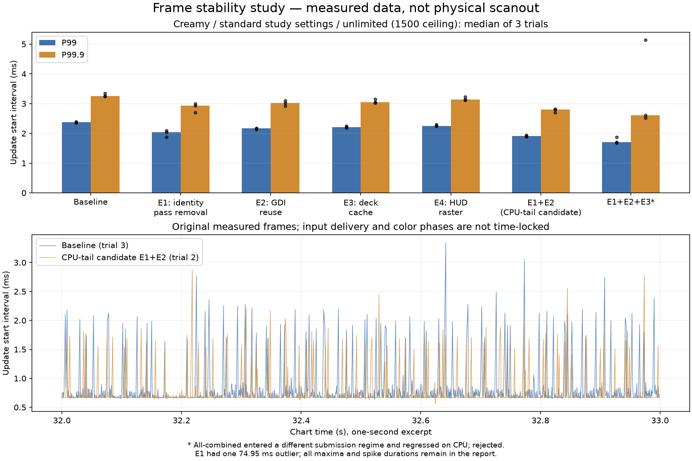

# 프레임 안정성 최적화 실험 결과 (2026-10-24)

## 판정과 조건부 추천

**입력 지연·실제 화면 안정성까지 통과한 최종 배포용 승자는 아직 확정하지 않았다.** CPU 처리 꼬리와 기능 검증 범위의 우선 검토 후보는 **E1+E2 텍스트 결합**이다. `codex/frame-exp-text-combined` / `95b17a1`에 코드가 있고, 동일 변경에 Present 시각 계측만 더한 `codex/frame-control-text` / `60735a9`로 출력 조건을 교차 확인했다. 메인 `21ff0ef`와 원래 `테스트` 브랜치 `687a29c`는 이동시키지 않았다. 최종 적용·병합·배포는 하지 않는다.

주 비교인 Creamy GPU replay의 3회 중앙값은 P99 **2.379 → 1.918ms (19.4% 감소)**, P99.9 **3.259 → 2.809ms (13.8% 감소)**였다. 평균 FPS보다 이 꼬리 감소와 CPU 모드 회귀 여부를 우선했다. 모든 드랍이나 실제 화면 끊김이 해결됐다는 결론은 아니다.

## 실제 사용자 설정 추가 대조

사용 중인 `build/Release/BmsPlayer-Test.ini`의 관련 항목을 뒤에 대조하면서, 초기 표준 조건과 다른 설정을 확인했다. 기존 기본 조건의 실험을 사용자 설정 실측이라고 부르지 않는다. Display/Sound/Gameplay/System/KeyBindings/NoteColors만 별도 INI로 복제해 추가 검증했다. 원래 설정·라이브러리·기록은 수정하지 않았다. 실제 설정은 FPS 무제한, 5.50x, 화면 모드 값 2, 버퍼 **32**, 자원 표시 ON, CPU 성능 모드 ON, Reflex ON, DirectComposition OFF다. 벤치마크의 게이지 NORMAL·구간·입력 스케줄은 모든 비교에서 고정했다. 자원 표시 OFF는 원인 분리용 대조이며 해결책으로 채택하지 않았다.

첫 추가 대조(user-*): 자원 표시 ON 원본의 업데이트 P99는 2.409ms, OFF 대조 2.240ms, ON 텍스트 결합 1.971ms였다. 원본 overlay 구간 관측 최대는 1.937ms였다. 이 장비에서 500ms 텔레메트리 수집 자체가 가장 큰 병목이라는 근거는 부족해 불필요한 worker/락 구조 변경을 추가하지 않았다. 원본에 66.444ms 시작 간격도 있었지만 overlay scope로 그 전체를 설명할 수 없었다. 원인 미확정으로 남겼다.

그 뒤 동일 실제 설정으로 원본/E1/E2/E1+E2 순서를 회전하는 균형 대조(paired-*), 각 3회를 추가했다. 아래는 중앙값이다.

| 버전 | update 평균 FPS | 1% Low | update P99 ms | update P99.9 ms | 표준편차 ms |
| --- | --- | --- | --- | --- | --- |
| 원본 | 1133.6 | 314.3 | 2.330 | 3.437 | 0.437 |
| E1 | 1138.1 | 370.9 | 2.005 | 3.257 | 0.298 |
| E2 | 1159.3 | 414.7 | 2.073 | 2.839 | 0.249 |
| E1+E2 | 1176.9 | 422.8 | 1.773 | 2.555 | 0.241 |

| 버전 | API 제출 P99 ms | API 제출 P99.9 ms | Post→handler P99 ms |
| --- | --- | --- | --- |
| 원본 | 7.062 | 16.017 | 0.163 |
| E1 | 8.025 | 17.108 | 0.110 |
| E2 | 7.106 | 8.143 | 0.162 |
| E1+E2 | 6.809 | 8.177 | 0.182 |

마지막 대조의 E1+E2는 업데이트 P99 약 23.9%, P99.9 약 25.7% 감소, 1% Low 약 34.5% 증가였다. **이 숫자만으로 최종 적용을 승인할 근거는 부족하다.** Post→handler P99가 0.163→0.182ms로 소폭 증가했고, 앞선 user-* 대조에서는 API 제출 P99가 원본 7.278ms보다 텍스트 결합 8.171ms로 나빠졌다. 표준 무제한 대조에서도 제출 P99 6.677→8.891ms 악화가 있었다. 마지막 대조에서 좋아진 제출 지표만 골라 전체 출력이 안정화됐다고 결론내리지 않는다. OS/표시 상태와 실제 회귀를 구분하지 못했으며, 입력 경로 미수정만으로 물리 지연 무회귀를 입증할 수도 없다.

따라서 E1+E2는 **추가 검증을 위한 조건부 후보**다. 실제 표시·입력 검증과 긴 꼬리 원인 확인 전에는 최종 해결책 선정/기본값 변경/메인 병합을 보류한다. GDI 작업면 유지에 따른 메모리와 clear 수명 정책도 최종 통합 시 검토한다.

## 원인 분석

1. 가장 강한 근거는 판정·콤보 **글자 이미지 재생성**이다. 새 콤보와 24ms PGREAT 색 전환이 캐시 miss를 만들고, GDI 이중 외곽선 렌더와 알파 복원이 실행된다. 이미 외곽선이 있는 HUD에도 불필요한 후처리 배열·전면 픽셀 순회가 있었고, miss마다 작업 DC/DIB를 다시 만들었다.
2. 입력과 느린 프레임이 함께 나타나지만 실제 판정 계산·키음 락은 훨씬 작았다. 기존 `judgement_ms`는 판정 알고리즘이 아니라 데크·텍스트를 포함하는 그리기 부모 구간이다. 실제 계산은 `judge_logic_ms`다.
3. 별도로 GDI 동기화의 긴 꼬리가 관측됐다. E1 1회에 시작 간격 74.945ms, 직전 처리 65.060ms 중 `GdiFlush` 54.183ms가 있었다. 제거하거나 평균에서 제외하지 않았다. 드라이버 대기와 OS 선점 중 무엇인지는 확정하지 못했다.
4. GPU 제출 환경이 달라지는 현상도 있다. 같은 무제한 설정에서 10초간 약 2,400개 혹은 13,000개 안팎의 Present 성공이 관측됐다. 따라서 CPU 업데이트 FPS, 그리기 FPS, API 제출, 실제 모니터 scanout을 구분한다. compositor/독립 flip 상태 변화는 후보 원인이며 이 자료만으로 확정할 수 없다.
5. 노트 수, 키 빔·히트 효과, 입력 계산, 오디오 락이 이번 7키 두 구간의 주원인이라는 근거는 약했다. 비단조 SCROLL의 전체 노트 검색, 많은 템포 이벤트, 다른 키 모드·연습 배속·다른 곡의 성능까지 일반화하지 않는다.

## 조건과 데이터 보존

총 1541088개 집계 구간 프레임을 분석했다. 상세 입력 이벤트가 있는 152회에서 집계 구간 미처리 입력 0을 확인했다. 축약 계측 6회는 해당 이벤트를 수집하지 않아 CSV도 미측정으로 표시했다. 158회 모두 audio empty-padding/render-failure 0, trace drop 0이었다. 이는 물리 오디오 무결성이나 무지연을 뜻하지 않는다. 비교/사전 확인용 154건은 실제 Git 커밋·보존 실행파일·초기 INI 해시를 검증했고, 원래 사용자 설정 해시도 유지됐다.

- Ryzen 7 9800X3D / 논리 16코어. 설치 GPU: GTX 1660 Ti(32.0.16.1714), Radeon 내장(32.0.21045.16010). 각 실행의 실제 DXGI 어댑터 식별자는 별도 수집하지 않았다. MSVC VS18 2026 x64 Release, mimalloc·oneTBB·hybrid ON, Tracy OFF.
- 1920×1080, 5.00x 노트 배속, BGA darkness 50, 레인 투명도 34, 오디오 버퍼 256, 자원 제한 모두 100%. 기본 비교는 무제한(1500 ceiling), DirectComposition/Reflex OFF. 두 곡을 30초 seek 후 10초 실행하고 31~39초만 집계했다. 긴 플레이 전체를 재현한 결과는 아니다.
- BMS seed 0x20261024. 자동 입력은 실제 WM_KEYDOWN/WM_KEYUP 핸들러를 통과한다. 10ms WM_TIMER로 같은 authored 입력열을 게시하지만 실제 도착은 OS 지터를 포함한다. 따라서 실행별 점수·색 위상이 완전히 같지는 않다. 별도 고정 시계 판정/LN 테스트로 알고리즘 회귀를 검증했다.
- 총 158회(본 비교 153회, clean 사전 확인 1회, 초기 scout 4회)를 기록했다. 본 비교는 조건별 세 번 반복하고 버전 순서를 회전했다. 빌드·회귀 테스트·다른 성능 실행을 측정과 겹치지 않았다. 모든 OS 백그라운드 작업·GPU 클럭·표시 모드를 고정한 전용 장비 시험은 아니다. 세 번의 중앙값과 범위를 제시하며 통계적 유의성을 주장하지 않는다.
- 평균 FPS=1000/평균 시작 간격. 1% Low=가장 긴 ceil(N×0.01) 간격의 평균의 역수. 백분위는 선형 보간, 표준편차는 모집단 기준. VSync의 FPS 열은 업데이트 루프 처리율이며 그리기/scanout FPS가 아니다.
- 초기 scout 4회와 clean 기준 사전 확인 r0은 최종 중앙값에서 제외했다. scout 바이너리는 계측 보강 중 재빌드되어 보존하지 못했으며 raw CSV/해시와 이 한계를 남겼다. 실제 비교용 바이너리는 해시별로 보존했다. final 결합 실험 manifest의 입력 커밋 ID 오타는 실제 worktree SHA로 교정하고 원래 입력과 교정 사유를 함께 보관했다. 수치·실행파일은 수정하지 않았다.
- 원본 패치: `build-frame-study/original-worktree.patch`, `original-index.patch`, `HudTextStyle-original.h`. 원본 소스는 Git 기준 커밋과 각 실험 worktree로 보존했다. 원래 staged CI/README/UI 변경을 실험 커밋에 포함하지 않았다.
- 원시 측정/이벤트/설정/manifest/로그: `build-frame-study/results/`. 실행파일·차트·초기 설정 SHA256과 UTC/seed/commit을 기록했다. 앱 종료 시 수정되는 설정과 구별해 초기 INI도 보존/해시 복원한다. 테스트 곡·빌드·로그·개인 설정은 Git에 넣지 않는다.
- 실행파일 보관: `build-frame-study/preserved-binaries/<SHA256 앞16자리>/`. 빌드 로그: `build-frame-study/*-build.log`, `*-configure.log`. 개별 원시 CSV 해시와 수치·소스/실행파일 해시는 [전체 측정 CSV](frame-study-results.csv)에 있다.

## 독립 실험과 결합 결과

| 버전 | 커밋 | 최소 변경 | GPU 평균 FPS | GPU P99 ms | GPU P99.9 ms | CPU 평균 FPS | CPU P99 ms |
| --- | --- | --- | --- | --- | --- | --- | --- |
| 기준 | 2af1307 | 원래 동작 | 1262.7 | 2.379 | 3.259 | 1051.2 | 2.402 |
| E1 | 106b061 | outlined=false의 항등 후처리 생략 | 1340.5 | 2.037 | 2.938 | 1066.2 | 2.139 |
| E2 | e2948b9 | 동일 크기 GDI DC/DIB 재사용 | 1330.1 | 2.167 | 3.018 | 1055.1 | 2.335 |
| E3 | 458844c | 키 배경 유지, 회전 디스크만 재생성 | 1331.8 | 2.213 | 3.053 | 1059.7 | 2.371 |
| E4 | 576db97 | 판정선/구분선을 CPU 픽셀로; 장벽 유지 | 1319.3 | 2.250 | 3.145 | 1059.6 | 2.356 |
| E1+E2 | 95b17a1 | 텍스트 변경만 결합; 추천 | 1349.6 | 1.918 | 2.809 | 1067.6 | 2.051 |
| E1+E2+E3 | 24b02cb | CPU 회귀로 기각 | 1378.5 | 1.710 | 2.613 | 974.2 | 2.475 |

E1은 모든 색·애니메이션과 기존 이중 외곽선을 유지한다. E2도 glyph/색·캐시 키·알파 계산을 유지한다. E3는 독립 실험에서 deck P99를 줄였지만 텍스트와 결합한 버전은 CPU 평균과 P99가 나빠져 추천에서 제외했다. E4는 정상 구간에서 작게 개선됐으나 드문 54ms 대기 제거를 입증하지 못했다. 무관한 변경을 한 실험에서 동시에 최적화했다고 처리하지 않았다.

E1+E2+E3의 GPU 측정은 제출 수가 적은 상태로 바뀌었으므로 그 GPU 개선율을 그대로 코드 효과로 해석하지 않는다. CPU 모드의 회귀는 출력 상태와 별개로 재현됐다. 평균 FPS가 높아 보인다는 이유로 채택하지 않았다.

## CPU 꼬리 개선 후보의 비교

| 시나리오 | 버전 | 평균 FPS | 1% Low | 평균 ms | P95 | P99 | P99.9 | 표준편차 ms |
| --- | --- | --- | --- | --- | --- | --- | --- | --- |
| creamy-gpu-replay | 기준 | 1262.7 | 373.5 | 0.792 | 1.835 | 2.379 | 3.259 | 0.361 |
| creamy-gpu-replay | 추천 | 1349.6 | 441.5 | 0.741 | 1.577 | 1.918 | 2.809 | 0.275 |
| creamy-cpu-replay | 기준 | 1051.2 | 319.4 | 0.951 | 1.937 | 2.402 | 3.825 | 0.378 |
| creamy-cpu-replay | 추천 | 1067.6 | 372.0 | 0.937 | 1.696 | 2.051 | 3.233 | 0.295 |
| happy-gpu-replay | 기준 | 1337.1 | 406.6 | 0.748 | 0.985 | 2.150 | 3.033 | 0.278 |
| happy-gpu-replay | 추천 | 1396.9 | 487.4 | 0.716 | 0.862 | 1.783 | 2.570 | 0.214 |
| creamy-gpu-idle | 기준 | 1408.6 | 527.6 | 0.710 | 0.802 | 1.772 | 2.051 | 0.169 |
| creamy-gpu-idle | 추천 | 1445.4 | 558.9 | 0.692 | 0.707 | 1.663 | 1.929 | 0.149 |

| 시나리오 | 버전 | 평균-1% Low FPS | Low/평균 | >2ms 프레임 | 그 구간 총 ms | 최장 연속 구간 ms |
| --- | --- | --- | --- | --- | --- | --- |
| creamy-gpu-replay | cleanbase | 889.1 | 29.6% | 393 | 904.9 | 6.275 |
| creamy-gpu-replay | combined | 908.0 | 32.7% | 77 | 185.0 | 5.293 |
| creamy-cpu-replay | cleanbase | 731.8 | 30.4% | 349 | 824.3 | 6.086 |
| creamy-cpu-replay | combined | 695.5 | 34.8% | 101 | 261.7 | 5.836 |
| happy-gpu-replay | cleanbase | 930.5 | 30.4% | 173 | 400.0 | 4.859 |
| happy-gpu-replay | combined | 909.6 | 34.9% | 44 | 103.7 | 3.118 |

위 스파이크 횟수·시간은 각 8초 창의 3회 중앙값이며, 정상적인 고정 240FPS 프레임(4.17ms)에 >2ms 기준을 적용해 성능 문제라고 부르지 않는다. GPU replay의 평균-1% Low 절대 차이는 커질 수 있으나 Low/평균 비율과 P99/P99.9는 개선됐다. 이 차이 하나로 승자를 선정하지 않았다.

| GPU replay | P99 실행별 범위 ms | P99.9 범위 ms | 전체 최대 간격 ms | 전체 최장 spike cluster ms |
| --- | --- | --- | --- | --- |
| 기준 | 2.349~2.389 | 3.242~3.345 | 4.422 | 8.057 |
| E1 | 1.870~2.093 | 2.700~2.994 | 74.945 | 81.176 |
| E2 | 2.137~2.171 | 2.916~3.099 | 4.004 | 7.505 |
| E3 | 2.186~2.248 | 3.023~3.153 | 3.750 | 5.268 |
| E4 | 2.244~2.296 | 3.111~3.233 | 4.069 | 5.975 |
| E1+E2 | 1.888~1.939 | 2.706~2.822 | 4.203 | 6.357 |
| E1+E2+E3 | 1.677~1.879 | 2.519~5.146 | 255.962 | 370.366 |

## 처리 구간별 비용과 상관관계

단위는 ms. 평균은 프레임당 합계이고 부모·자식이 중첩되므로 열을 더하면 안 된다. 오디오 worker 값은 해당 UI 회수 구간의 누적치다. 정규 루프 외부 WM_PAINT/대기는 다음 행의 pending scope로 기록될 수 있어 `frame_ms`보다 scope가 클 수 있다.

| scope | 기준 평균/프레임 | 기준 P99 | 기준 max | 추천 평균/프레임 | 추천 P99 |
| --- | --- | --- | --- | --- | --- |
| position_ms | 0.000717 | 0.002100 | 0.045900 | 0.000690 | 0.001800 |
| bga_ms | 0.347689 | 0.889732 | 2.214100 | 0.239381 | 0.775550 |
| hud_ms | 0.005331 | 0.022576 | 0.066200 | 0.005270 | 0.013700 |
| sync_ms | 0.000601 | 0.001000 | 0.037500 | 0.000595 | 0.001100 |
| notes_ms | 0.010011 | 0.028384 | 0.082100 | 0.010010 | 0.029900 |
| judgement_ms | 0.217464 | 1.742517 | 2.300400 | 0.199241 | 1.401548 |
| present_ms | 0.135829 | 0.669394 | 1.562500 | 0.119358 | 0.665220 |
| decode_ms | 0.000000 | 0.000000 | 0.000000 | 0.000000 | 0.000000 |
| image_ms | 0.003569 | 0.150096 | 0.273100 | 0.003250 | 0.145725 |
| shade_ms | 0.000000 | 0.000000 | 0.000000 | 0.000000 | 0.000000 |
| tint_ms | 0.000000 | 0.000000 | 0.000000 | 0.000000 | 0.000000 |
| video_ms | 0.000117 | 0.000300 | 0.031300 | 0.000120 | 0.000300 |
| resource_ms | 0.000000 | 0.000000 | 0.000000 | 0.000000 | 0.000000 |
| overlay_ms | 0.000000 | 0.000000 | 0.000000 | 0.000000 | 0.000000 |
| deck_ms | 0.046687 | 0.157100 | 0.406400 | 0.044551 | 0.164420 |
| beams_ms | 0.015633 | 0.042400 | 0.119900 | 0.015234 | 0.040000 |
| feedback_ms | 0.001191 | 0.002500 | 0.284000 | 0.001186 | 0.002900 |
| text_ms | 0.091010 | 1.594892 | 2.086300 | 0.075191 | 1.235792 |
| bga_copy_ms | 0.330434 | 0.478934 | 0.948500 | 0.223033 | 0.387684 |
| backplate_build_ms | 0.013527 | 0.560876 | 1.045700 | 0.012414 | 0.553425 |
| upload_ms | 0.062746 | 0.548398 | 1.385700 | 0.061665 | 0.551308 |
| gpu_draw_ms | 0.049032 | 0.116388 | 0.334500 | 0.048985 | 0.134700 |
| gpu_queue_ms | 0.021503 | 0.062396 | 0.149100 | 0.021236 | 0.065304 |
| input_ms | 0.000034 | 0.000000 | 0.026600 | 0.000038 | 0.000000 |
| judge_logic_ms | 0.000005 | 0.000000 | 0.001700 | 0.000006 | 0.000000 |
| trigger_lock_ms | 0.000000 | 0.000000 | 0.000300 | 0.000000 | 0.000000 |
| wait_ms | 0.000000 | 0.000000 | 0.000000 | 0.000000 | 0.000000 |
| latency_wait_ms | 0.000562 | 0.002900 | 0.088500 | 0.000471 | 0.002900 |
| audio_mix_ms | 0.000375 | 0.008300 | 0.044600 | 0.000356 | 0.008400 |
| audio_lock_ms | 0.000012 | 0.000200 | 0.000500 | 0.000010 | 0.000200 |

| 요인 | 현재 processing r | 현재 interval r | 이전 프레임 요인→다음 interval r |
| --- | --- | --- | --- |
| key_down | 0.175 | 0.135 | 해당 없음 |
| key_up | 0.093 | 0.102 | 해당 없음 |
| judgements | 0.152 | 0.145 | 해당 없음 |
| text_misses | 0.822 | 0.032 | 0.812 |
| cpp_allocations | 0.630 | 0.104 | 0.620 |
| visible_notes | 0.015 | 0.013 | 0.018 |
| bga_rebuilt | 0.499 | 0.034 | 0.497 |

상관은 원인 확정이 아니다. 입력이 콤보와 새 glyph를 함께 만들기 때문에 입력 비용과 텍스트 비용을 구분해야 한다. 현재 처리 비용은 다음 시작 간격에 반영되므로 이전 프레임 상관도 함께 기록했다. 24ms 위상별 spike 비율과 5ms 간격 히스토그램은 원시 JSON에 있으며, 글자 색 전환과의 연관을 지지하지만 모든 spike가 24ms 주기라는 뜻은 아니다.

관련 소스: `Main.cpp::pressLane/WM_KEYUP/showTimingJudgement/updatePlaybackFrame/drawGameScreen/drawAnimatedCenteredText/drawBgaBackplate/waitForPlaybackWork`, `TextRasterCache.h::draw`, `KeyDeck.h::drawCached/draw`, `AudioEngine.cpp::trigger/fillBuffer`, `CompositionPresenter.h::present/drawFrame/finishPresentation`, `FramePacer.h`, `ExperimentalAllocator.cpp`. 각 변경의 정확한 위치는 위 커밋으로 재현할 수 있다.

## Present·VSync·Reflex·DirectComposition 대조

공통 Present probe 버전: 원본 `70596ed`, 추천 `60735a9`. 성공한 `Present(S_OK)` 반환 직후 메모리에 시각만 남겼다. 아래 제출 간격은 **API 수락 간격**이며 물리 scanout/완성된 화면 표시 간격이 아니다. VSync에서는 update가 계속되면서 paint가 생략될 수 있으므로 업데이트 FPS와 제출 FPS를 합쳐 해석하면 안 된다.

| 조건 | 버전 | update FPS | API 제출 FPS | 제출 P99 ms | 제출 P99.9 ms | 제출 표준편차 ms |
| --- | --- | --- | --- | --- | --- | --- |
| creamy-gpu-replay | cad-base | 1298.9 | 235.4 | 6.677 | 7.721 | 0.728 |
| creamy-gpu-replay | cad-text | 1292.8 | 226.5 | 8.891 | 12.761 | 1.207 |
| creamy-gpu-240-replay | cad-base | 237.7 | 224.0 | 9.064 | 18.495 | 1.382 |
| creamy-gpu-240-replay | cad-text | 239.7 | 219.8 | 8.195 | 8.739 | 1.110 |
| creamy-gpu-vsync-replay | cad-base | 1120.4 | 212.6 | 9.064 | 16.649 | 1.776 |
| creamy-gpu-vsync-replay | cad-text | 1125.7 | 212.9 | 8.771 | 9.989 | 1.345 |
| creamy-gpu-reflex-replay | cad-base | 1103.7 | 227.0 | 7.379 | 10.846 | 1.108 |
| creamy-gpu-reflex-replay | cad-text | 1112.4 | 225.9 | 7.726 | 13.530 | 1.612 |
| creamy-gpu-dc-replay | cad-base | 1228.0 | 215.5 | 12.158 | 18.047 | 1.765 |
| creamy-gpu-dc-replay | cad-text | 1308.5 | 228.7 | 7.946 | 11.185 | 0.984 |

Reflex 조건 6회에서 reflex_active=1, driver_low_latency=1을 확인했다. 각 실행별 수치와 범위는 CSV에 남겼다. native 무제한의 제출 모드는 반복 중 달라질 수 있으며, 이를 숨기고 하나의 개선율로 환산하지 않는다. VSync/Reflex의 지연·FPS 정책을 코드에서 변경하지 않았다. 지원 요청과 실제 활성화 상태는 각 로그의 reflex_active/driver_low_latency로 구별한다.

### 상세 계측 부하 대조

| 계측 | update FPS | P99 ms | P99.9 ms | API 제출 FPS |
| --- | --- | --- | --- | --- |
| cad-base | 1298.9 | 2.407 | 3.329 | 235.4 |
| cad-base-min | 1245.0 | 2.570 | 3.590 | 232.6 |
| cad-text | 1292.8 | 2.253 | 3.206 | 226.5 |
| cad-text-min | 1326.3 | 2.046 | 2.852 | 235.1 |

min은 scope/입력 이벤트/할당·worker 카운터를 줄인 경계 계측 대조다. 프레임 버퍼와 Present 시각 및 일부 worker 시작 시각 비용은 남는다. 따라서 무계측 실행과 동일하지 않다. 실행별 제출 환경/OS 지터가 달라진 경우 이 차이를 전부 계측 오버헤드로 단정하지 않는다. 프로브는 일반 배포 타깃에서 컴파일되지 않는다. 이 대조만으로 상세 계측의 순수 비용이 0이거나 특정 %라고 주장할 수 없다.

## 입력·오디오·메모리 및 회귀 검증

| 버전 | Post→handler 평균 ms | Post→handler P99 ms | 예정시각→처리 P99 ms | 집계구간 미처리 입력 |
| --- | --- | --- | --- | --- |
| cleanbase | 0.019 | 0.065 | 16.255 | 0 |
| combined | 0.026 | 0.135 | 15.982 | 0 |

예정시각→처리는 WM_TIMER의 약 10ms 이상 스케줄 지터를 포함한다. Post→handler는 실제 메시지 처리 경로의 소프트웨어 비교이며 USB/키보드·광학 입력 지연을 측정한 값이 아니다. Happy에는 벤치 종료 시점인 40초의 두 KEYDOWN이 게시된 뒤 창이 닫혀 처리되지 않은 기록이 모든 버전에 동일하게 있다. 집계 창 31~39초 밖이며 이를 처리된 입력이라고 세지 않는다.

텍스트 결합 및 최종 결합 후보에서 판정·롱노트·스코어·게이지·피치 보존·BMS 확장·키음/오디오·BGA/비디오·GPU/저지연 상태·빔·히트 효과 등의 기존 자동 테스트를 실행했다. 텍스트 결합의 CTest 최초 결과는 23/24였고, 라이브러리 테스트만 깊은 worktree 경로에서 실패했다. 같은 기준 소스도 같은 깊은 경로에서 실패했으며 두 버전 모두 짧은 독립 경로에서 통과했다. 최종 결합은 해당 경로 의존 테스트를 분리해 CTest 23/23 + 라이브러리 수동 실행 1개가 통과했다. 사용자 UI 전체 자동 시나리오는 실행하지 않았다. 긴 경로 제약은 남아 있다.

추가 픽셀 검증: E1/E2/텍스트 결합은 96개 BankGothic 텍스트·스케일·색·클리핑 조합, 기어 변경은 1,024개 눌림/회전/크기/이미지 세대/스크래치 폭 조합에서 frozen 원본과 일치했다. GDI 선 변경도 18개 전체 픽셀 비교와 Display GPU 테스트를 통과했다. 장식 효과를 끄지 않았다. PGREAT 24ms 색 변화, 키 빔, 키음, 히트 효과, 진단 비프를 유지했다.

- cleanbase GPU replay 프로세스 peak working set: 중앙값 385.0MiB, 범위 361.3~396.5MiB. 로딩/계측 버퍼/GPU staging까지 포함한 프로세스 수치이며 게임 캐시 순증가량과 같지 않다.
- combined GPU replay 프로세스 peak working set: 중앙값 378.2MiB, 범위 375.1~383.3MiB. 로딩/계측 버퍼/GPU staging까지 포함한 프로세스 수치이며 게임 캐시 순증가량과 같지 않다.

E2는 캐시별 DC와 같은 크기의 DIB 두 장을 보관한다. glyph 렌더 결과를 재사용하지 않는 동안과 clear() 후에도 이 작업면이 유지되는 교환 조건이 있다. 일반 C++ new/free 카운트는 UI thread의 mimalloc 경로만 포함하고 aligned/CRT/COM/GDI/드라이버 할당은 포함하지 않는다. 오디오 empty-padding/render-failure 및 trace drop은 원시 실행 로그를 확인하며, 0인 audio_thread_cpu_ms는 해상도/조회 한계가 있어 무부하로 해석하지 않았다.

## 한계와 재현·후속 검증

1. 실제 모니터 scanout·물리 키 입력 지연·들리는 오디오와 BGA의 광학 동기는 미검증이다. 현재 측정은 앱·API 시각이며 외부 입력 LED/카메라/오디오 loopback 기준이 없다. 같은 곡/설정에서 입력 LED와 화면을 촬영하고 오디오 loopback/화면 타임스탬프를 대조해야 한다. 입력 지연이 개선됐다고 주장하지 않는다.
2. 긴 연속 플레이·저사양 PC·다른 키 모드/곡/비단조 스크롤의 성능, 실제 장치 제거/드라이버 리셋은 이번 실측 범위 밖이다. 수치/지원 여부를 추정해 채우지 않는다. 공통 seed와 exe/chart/config hash를 확인하고 동일한 짧은 구간을 3회 이상 다시 측정한다. 연속 플레이는 별도 테스트 실행파일로 곡 전체를 반복해 확인해야 한다.
3. 재현: 각 표의 커밋에서 별도 worktree를 만들고 VS18 2026 x64 Release / BMS_USE_MIMALLOC=ON / BMS_USE_ONETBB=ON / BMS_HYBRID_RENDERER=ON / BMS_USE_TRACY=OFF로 configure한다. `BmsGameplayProfile`, `BmsFrameStudyRasterTests` 타깃을 빌드한다. 라이브러리는 기존 `cmake/PerformanceLibraries.cmake`의 고정 해시를 사용했다.
4. 실행: `./tools/Run-FrameStudy.ps1 -Profiler <exe> -Label <label> -Repeat 1 -SourceCommit <검증한SHA>`를 2·3회 순서를 바꿔 반복한다. `-Cases creamy-gpu-240-replay` / `creamy-gpu-vsync-replay` / `creamy-gpu-reflex-replay` / `creamy-gpu-dc-replay`, `-BoundaryOnly`로 조건을 구분한다. 초기 INI·runtime INI와 manifest를 함께 보존한다. `-ConfigTemplate <ini>`는 관련 설정 섹션만 복사하고 라이브러리/개인 기록을 제외한다. CPU/GPU·FPS·Reflex는 case의 명시적 CLI 값이 우선하므로 실제 설정 대조는 `creamy-gpu-user-reflex-replay`를 사용했다.
5. 집계: `python tools/Analyze-FrameStudy.py build-frame-study/results --output build-frame-study/summary.json --csv docs/frame-study-results.csv`. 그림 도구는 Matplotlib/NumPy가 필요하다. 그림: `python tools/Plot-FrameStudy.py build-frame-study/summary.json build-frame-study/results docs/frame_study_comparison.png`. 보고서의 추천 판정은 수치를 읽은 연구 판단이며 다른 장비에서 자동으로 동일 결론이 되는 것은 아니다.
6. **승인 전에는 병합하지 않는다.** 승인하면 E1+E2를 검증용 통합 브랜치에 적용하고, 비프/불필요한 계측 정리 후 판정·LN·스크래치·오디오·BGA·이펙트·입력/출력 회귀 및 최종 성능을 다시 확인한다. 원인 불명 장시간 스파이크와 출력 불안정이 중요하게 남아 있으면 병합하지 않는다. 기어·GDI 실험은 별도 보존하며 자동으로 함께 넣지 않는다.
